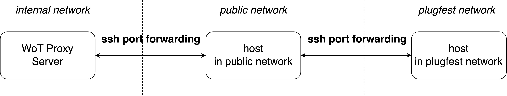
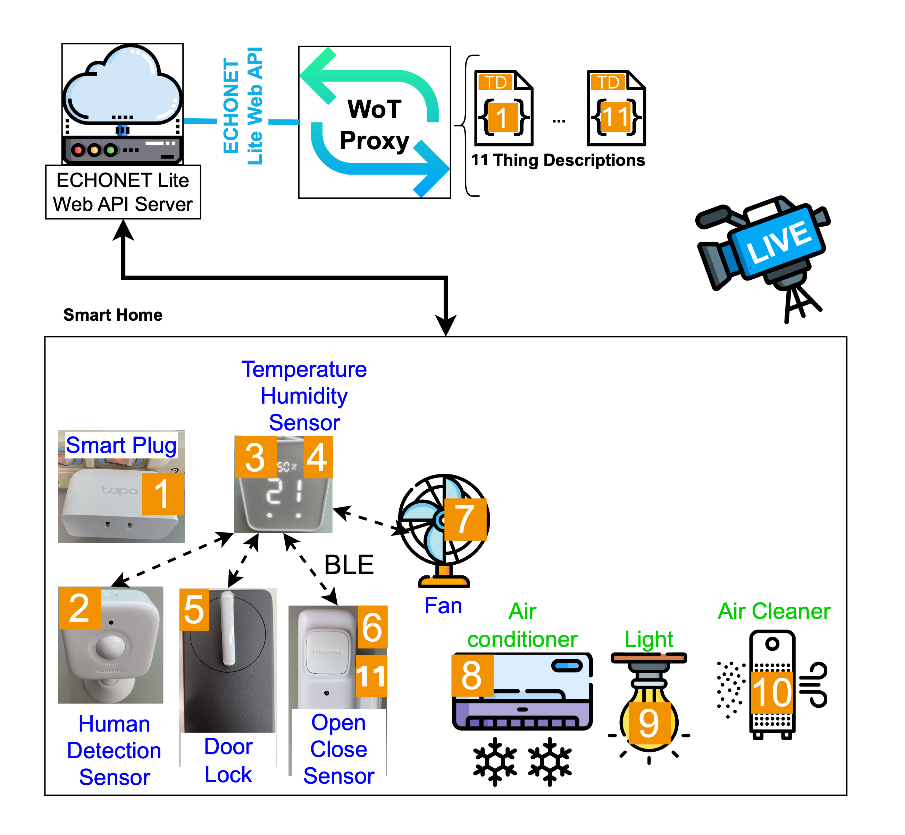

# ECHONET

## ECHONET Lite Smart Home Appliances

### Remote: 11 devices 

For access from Dublin, see [ECHONET in Dublin](../ECHONET-in-Dublin/).

#### Connection
All devices connect to the plugfest network by SSH port forwarding through a host that in public network.

#### Devices

- [Smart Plug (1)](./TDFiles/smartPlug.td.jsonld)
- [Human Detection Sensor (2)](./TDFiles/humanDetectionSensor.td.jsonld)
- [Temperature Sensor (3)](./TDFiles/temperatureSensor.td.jsonld)
- [Humidity Sensor (4)](./TDFiles/humiditySensor.td.jsonld)
- [Electric Lock (5)](./TDFiles/electricLock.td.jsonld)
- [Open Close Sensor (6)](./TDFiles/openCloseSensor.td.jsonld)
- [SmartPlug/Fan (7)](./TDFiles/smartPlug2.td.jsonld)
- [Air Conditioner (8)](./TDFiles/airconditioner.td.jsonld)
- [Ceiling Light (9)](./TDFiles/ceilingLight.td.jsonld)
- [Air Cleaner (10)](./TDFiles/airCleaner.td.jsonld)
- [Human Detection sensor(11)](./TDFiles/humanDetectionSensor2.td.jsonld)

You can confirm the operation of remote devices via web camera!

Have fun!