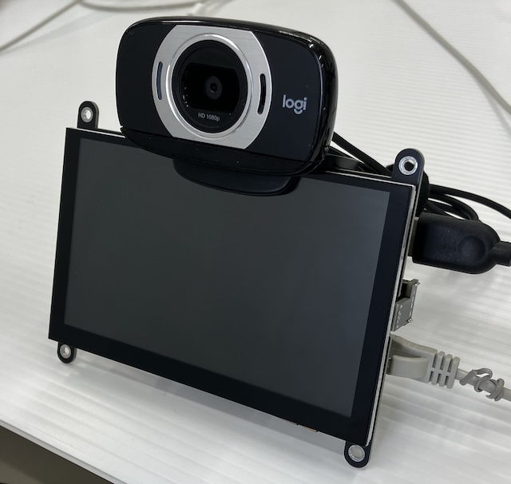
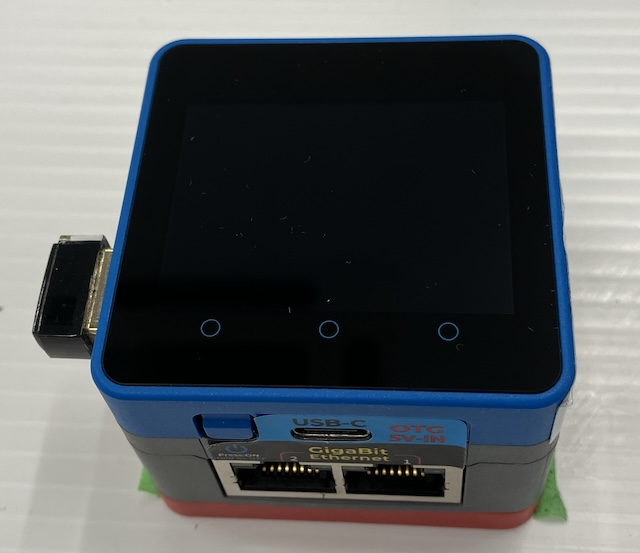
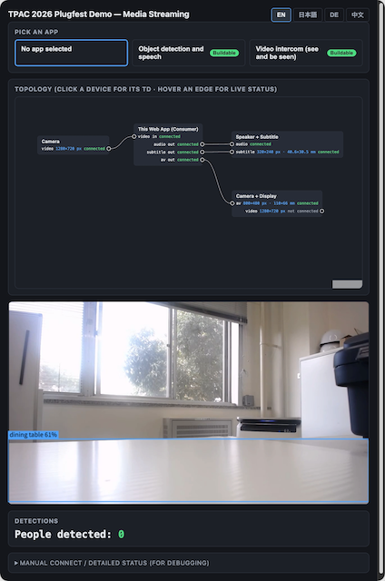

# Things and Consumer at TPAC 2026

This directory holds the Thing Description of the two Things we bring to the TPAC 2026 Plugfest.

> **Note:** The media-streaming vocabulary of these TDs are provisional and subject to change. They are not standardized and are not endorsed by the W3C WoT WG.

## Camera + Display

- TD: [`cam_disp.td.jsonld`](./cam_disp.td.jsonld)
- Hardware: Raspberry Pi 4B, 5-inch HDMI panel with speaker, Logitech C615 webcam
- Software: [MediaMTX](https://mediamtx.org/) + Python
- Role: Sends the camera's video; receives one audio+video stream and plays it

## Speaker + image display

- TD: [`speaker_image.td.jsonld`](./speaker_image.td.jsonld)
- Hardware: M5Stack CoreMP135
- Software: [MediaMTX](https://mediamtx.org/) + Python
- Role: Receives an audio stream; show an image

## Consumer: Object detector / Video intercom

- Hardware: Macbook Pro
- Software: Web browser (using WebGPU, WebTransport, WebRTC, etc.)

The consumer reads TDs from Thing Directory, decides which applications can be built from them, and connects the media streams.
